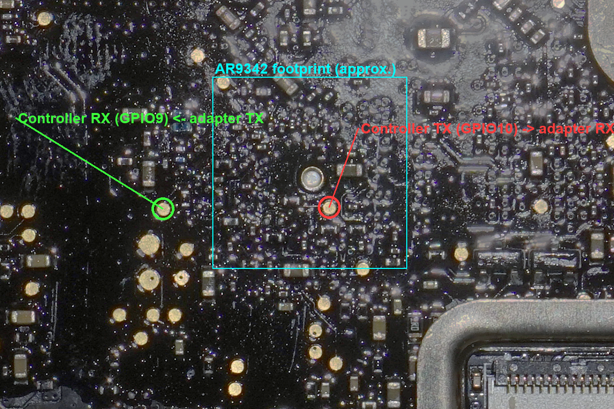
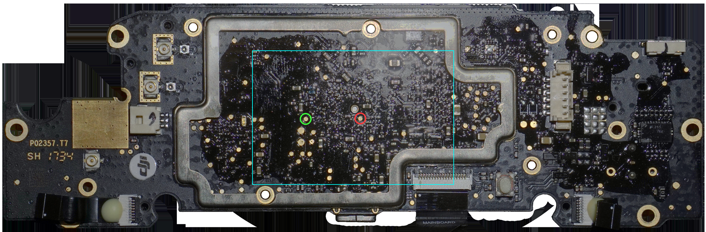

# DJI GL100 — UART console pads

Serial console location on the DJI GL100 mainboard. Verified on real hardware.

| | |
|---|---|
| Board ID | `P02357.T7` (date code `SH 1734`) |
| SoC | Qualcomm Atheros **AR9342-BL1A** (bottom side) |
| RAM | Winbond W9751G6KB (DDR2) |
| Console | **115200 8N1, 3.3 V logic** |

## Pads

Both pads are on the **top side**, under the main shield can (remove the shield lid).

| Marker | Signal | SoC pin | Connect to adapter |
|---|---|---|---|
| Red | Controller **TX** (GPIO10 / UART0_SOUT) | B46 | adapter **RX** |
| Green | Controller **RX** (GPIO9 / UART0_SIN) | A53 | adapter **TX** |
| — | **GND** | — | adapter GND |

- **TX** is the test point just below-right of the large via in the centre of the SoC footprint.
- **RX** is the isolated test point to the left of the SoC footprint, at about the same height as TX.
- **GND**: any ground works. The large rectangular gold shield on the top side and the mounting-hole rings are easy to use.

Approximate pixel coordinates in [`images/board_top.png`](images/board_top.png) (4200×1382): TX ≈ (2143, 705), RX ≈ (1818, 708).

## Notes

- Use a **3.3 V** USB-UART adapter. Do not use 5 V.
- The pins are the AR934x default UART0 mapping (GPIO9 = SIN, GPIO10 = SOUT). Pin numbers come from the AR9341 datasheet, which uses the same 150-pin dual-row LPCC package.
- GPIO10 is also the DDR-type bootstrap. It is pulled high for DDR2, so TX idles high.
- The bottom view of the SoC is mirrored on the top side. Seen from the top, the UART edge of the SoC faces the DJI-logo end of the board.

## Not yet verified

- **JTAG**: defaults are GPIO0–3 (TCK/TDI/TDO/TMS, pins B23/A28/B24/A29), on the bottom edge of the SoC near RESET_L (A23). Candidate test points are below the bottom-right of the footprint on the top side. Untested.
- **JTAG** remains untested.
- The console accepting input, the U-Boot interrupt, and getting a shell are **now documented** — see [Further documentation](#further-documentation) below.

## Photos

- [`images/board_top.png`](images/board_top.png): full top side
- [`images/board_bottom.png`](images/board_bottom.png): full bottom side

## Further documentation

Continuing from the pad location above, [`docs/`](docs/) covers the rest of the path to a root
shell and the firmware, and [`tools/`](tools/) has the scripts. Start at
[`docs/00-overview.md`](docs/00-overview.md).

- The console **accepts input**; **root login** works (`root` + DJI's shared firmware password). See [`docs/02-uart-console.md`](docs/02-uart-console.md).
- The **U-Boot serial autoboot-abort is disabled** by DJI (`Press S` is vestigial) — log in to Linux instead.
- The full **8 MB SPI flash can be dumped over the serial console** (no clip needed), md5-verified. See [`docs/04-dumping-over-serial.md`](docs/04-dumping-over-serial.md) and [`tools/serial_dump.py`](tools/serial_dump.py).
- **Flash layout** (MTD map, A/B kernels): [`docs/03-flash-layout.md`](docs/03-flash-layout.md).
- **Firmware internals** — A/B LZMA `uImage` kernels (non-standard LZMA props byte `0x6d`) with an **embedded `newc` cpio initramfs** (no squashfs); extracted OpenWrt Barrier Breaker 14.07 / kernel 3.10.49. See [`docs/05-firmware-internals.md`](docs/05-firmware-internals.md) and [`tools/unpack_firmware.py`](tools/unpack_firmware.py).
- **Gotchas** — watchdog (don't `kill -STOP apsrv`), flaky AR6006 USB-wifi enumeration, MCU-side auto power-off, telnet gate: [`docs/06-gotchas-and-findings.md`](docs/06-gotchas-and-findings.md).

## License

Text and images: [CC BY 4.0](https://creativecommons.org/licenses/by/4.0/).

Added documentation under `docs/` and `tools/`: same [CC BY 4.0](https://creativecommons.org/licenses/by/4.0/) unless noted.
